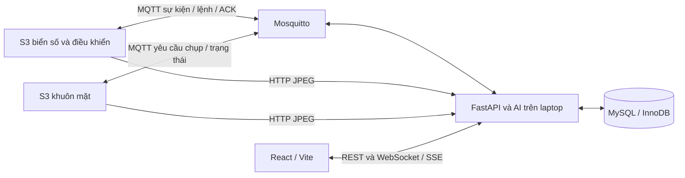

# Cấu trúc dự án PBL4 - Bãi đỗ xe thông minh

Tài liệu phản ánh source đang dùng sau đợt dọn dẹp ngày 22/11/2026. Cấu hình và trình tự chạy chi tiết ở [hướng dẫn tích hợp](docs/setup/system-integration.md).

## 1. Kiến trúc vận hành

- Hai bo ESP32-S3 N16R8/OV5640 cùng laptop kết nối một mạng Wi-Fi 2.4 GHz.
- Bo `s3_plate_ctrl` chụp biển số, đọc 6 IR, điều khiển 2 servo, OLED.
- Bo `s3_face_cam` nhận yêu cầu chụp khuôn mặt qua MQTT và gửi ảnh JPEG qua HTTP.
- Backend FastAPI chạy AI, xử lý giao dịch MySQL, kiểm tra quyền mở cổng và gửi lệnh MQTT.
- React/Vite cung cấp các route `/login`, `/user`, `/admin`; nhận thông báo qua WebSocket/SSE và tải dữ liệu qua REST API.
- MySQL/InnoDB trên laptop là nguồn dữ liệu vận hành. SQLite chỉ được dùng trong bộ test cô lập.



Backend quyết định cấp quyền; firmware kiểm tra đúng lượt, hạn lệnh và trạng thái IR trước khi điều khiển barie. ACK nhận lệnh không đồng nghĩa xe đã qua cổng. Mẫu khuôn mặt được mã hóa trong database; ảnh khuôn mặt chỉ giữ trong RAM để xử lý.

## 2. Các thư mục chính

```text
doan_PBL4/
├── contracts/                     # Trạng thái, mã lỗi, tuyến xe, checksum model
├── dashboard/
│   ├── src/app/App.tsx            # Điều hướng và phiên đăng nhập
│   ├── src/features/              # Giao diện User, Admin và các thành phần UI
│   ├── src/services/              # REST API, xác thực, đặt chỗ, phiên và review
│   ├── src/test/                  # Kiểm thử tuyến mô phỏng đường đi
│   ├── spa.py                     # Ghép giao diện dự phòng; backend vẫn sử dụng
│   └── serve_frontend.py          # Server phát triển giao diện tùy chọn
├── deployment/mosquitto/          # Cấu hình broker và ACL theo vai trò
├── docs/                          # Thiết kế, giao thức, setup và nghiệm thu
├── edge-server/
│   ├── src/smart_parking/
│   │   ├── ai/face/               # Khuôn mặt, chất lượng, liveness và đối sánh
│   │   ├── ai/plate/              # Adapter nhận diện biển số, chuẩn hóa, kiểm tra
│   │   ├── application/services/  # Điều phối cổng và nghiệp vụ giao dịch
│   │   ├── domain/                # Kiểu dữ liệu, trạng thái và lỗi nghiệp vụ
│   │   ├── infrastructure/        # MySQL, bảo mật, MQTT và mDNS
│   │   ├── interfaces/http/       # FastAPI, REST, HTTP ảnh và realtime
│   │   └── workers/               # Có worker hết hạn booking và dọn mẫu phiên
│   ├── migrations/                # Schema MySQL và khóa ngoại
│   ├── scripts/                   # Khởi tạo, seed, mẫu khuôn mặt và chẩn đoán
│   └── tests/                     # Test nghiệp vụ, bảo mật, AI và giao thức
├── firmware/
│   ├── platformio.ini             # plate-controller, face-camera, wokwi-controller
│   └── esp32_smart_parking/        # Firmware hai S3; tác vụ mạng tách vòng điều khiển
├── modules/license_plate_yolo_numpy/ # YOLO và OCR NumPy, có test riêng
└── scripts/
    ├── check_environment.py        # Kiểm tra source, dependency và TCP tùy chọn
    ├── check_contracts.py          # Kiểm tra cú pháp JSON
    ├── start_backend.ps1           # Khởi động backend trên Windows
    └── run_ui_sandbox.py           # UI thử nghiệm với DB trong RAM
```

Một số thư mục giữ lại còn chứa thành phần dự phòng hoặc khung phát triển; không phải mọi file trong cây đều nằm trên luồng vận hành. Các YAML trong `edge-server/configs/` không thay cho cấu hình thực tế từ `.env` và `Settings`.

## 3. Điểm vào và tài liệu cần dùng

| Phần | Điểm vào / tài liệu |
| --- | --- |
| Backend | `scripts/start_backend.ps1`, `smart_parking.interfaces.http.app:app` |
| Frontend | `dashboard/src/main.tsx`, `npm run build` trong `dashboard/` |
| Firmware | `firmware/platformio.ini`, [bảng chân](docs/setup/hardware-wiring.md) |
| Dữ liệu | [schema MySQL](docs/database/mysql-schema.md), [ERD](docs/diagrams/database-erd.mmd) |
| Thiết bị | [hợp đồng HTTP/MQTT](docs/protocols/mqtt-http-device-contract.md) |
| Kiểm thử | [nghiệm thu](docs/testing/acceptance-scenarios.md), [kết quả kiểm tra](docs/testing/runtime-verification.md) |

## 4. Mục đã loại khỏi source

Đã bỏ Firebase runtime/rules/contracts, AI đếm ô đỗ, workflow chỉ có `pass`, các sketch test chưa triển khai, kịch bản hệ thống chưa có runner, script đánh giá chỉ có chú thích và bản HTML xem trước sinh tự động. Tài liệu lịch sử có thể vẫn nhắc đến kiến trúc đã ngừng dùng.

Giữ test nghiệp vụ và `tests/fakes/fake_mysql_db.py`; không đưa test server vào luồng demo thật. Giữ model, `.env`, `config.local.h`, `dashboard/dist`, `node_modules` và firmware đã build trên máy phục vụ demo; các tài nguyên cục bộ này không nằm trong đợt xóa source.

Việc xóa khung đánh giá không thay thế nghiệm thu: độ chính xác AI, liveness, độ trễ và hoạt động camera/IR/servo trên hai bo thật vẫn cần đo và ghi nhận riêng.
